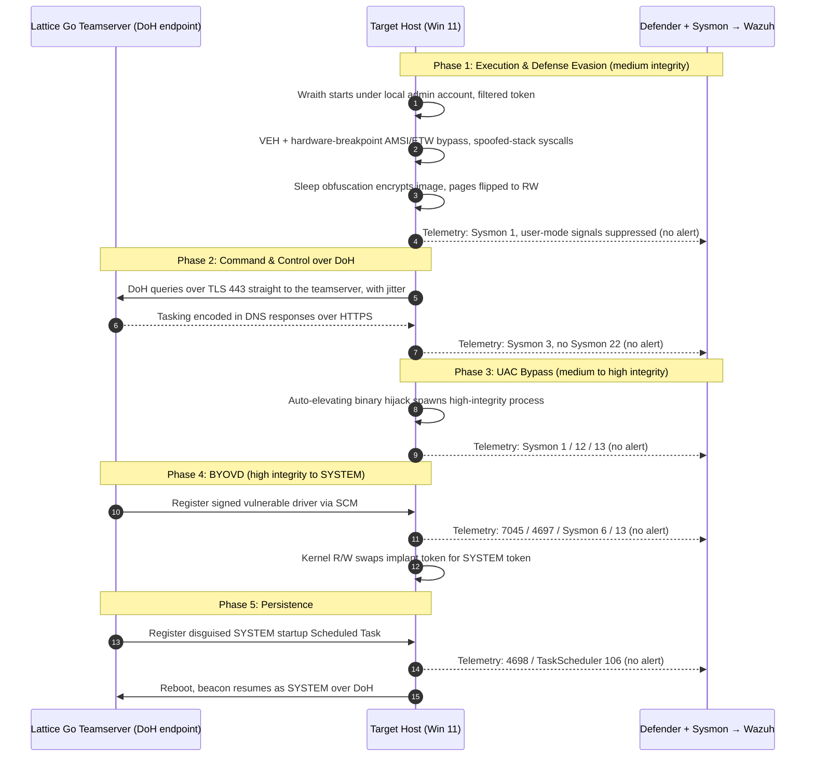

# Adversary Emulation Case Study: Medium-Integrity Foothold → UAC Bypass → BYOVD → SYSTEM Persistence


_%7C_Wraith_(Rust)_%7C_DoH-orange?style=flat-square)


> **Disclaimer:** All testing documented in this repository was conducted strictly within an isolated, privately owned home lab environment for offensive security research and defensive telemetry validation. No third-party systems were targeted.

---

## 📋 Table of Contents
1. [Engagement Overview](#-engagement-overview)
2. [Lab Topology & Participants](#-lab-topology--participants)
3. [Executive Summary](#-1-executive-summary)
4. [Visual Attack Flow (Mermaid)](#-2-visual-attack-flow)
5. [MITRE ATT&CK® Mapping](#-3-mitre-attck-framework-mapping)
6. [Technical Walkthrough & Operator Log](#-4-technical-walkthrough--operator-log)
7. [DFIR & Host-Based Forensic Artifacts](#-5-dfir--host-based-forensic-artifacts)
8. [Evasion Layer vs. Telemetry Source Matrix](#-6-evasion-layer-vs-telemetry-source-matrix)
9. [Detection Engineering: Sigma Rules](#-7-detection-engineering-sigma-rules)
10. [Findings & Remediation](#-8-findings--remediation)

---

## 🎯 Engagement Overview

| Metadata | Details |
| :--- | :--- |
| **Assessment Type** | Assumed-Breach Adversary Emulation & Detection Validation |
| **Engagement ID** | `[LAB-2026-XXX]` |
| **Assessment Window** | November 20 – 23, 2026 |
| **Operator** | Jessie Parker |
| **Target Environment** | `[TARGET-HOST-01]` — Windows 11 `[edition / build]` on an isolated lab subnet |
| **Emulation Stack** | **Project Lattice** (Go teamserver) + **Wraith** (Rust implant), DNS-over-HTTPS to a teamserver-hosted endpoint |
| **Primary Kill Chain** | Wraith at medium integrity ➔ VEH-based AMSI/ETW bypass, stack spoofing & sleep obfuscation ➔ **DoH** beacon ➔ **UAC bypass** to high integrity ➔ **BYOVD** token swap to SYSTEM ➔ disguised startup **Scheduled Task** |
| **Privilege Achieved** | Medium-integrity session (local admin account) ➔ high-integrity admin ➔ kernel read/write ➔ `NT AUTHORITY\SYSTEM` with reboot-resilient persistence |
| **Detection Outcome** | 0 Defender detections · 0 Wazuh alerts across all five phases |
| **Overall Risk Rating** | **Critical** |
| **Key Takeaway** | Every privileged step traced back to one setting: a daily-use account in the local Administrators group under default UAC. From there, the zero-alert result hid two different problems — UAC, driver, and task events that were **logged but never alerted on** (a configuration gap), and an in-memory evasion layer the lab's sensors **cannot see** (a visibility gap). |

---

## 🗺️ Lab Topology & Participants

| Participant | Description | Role in the Engagement |
| :--- | :--- | :--- |
| **Teamserver Host** | `[OS / VM type]` running the Project Lattice Go teamserver, which also hosts the DoH endpoint at `[https://c2.example-domain.tld/dns-query]`. | C2 backend and the only destination the target talks to for C2. Wraith connects to it directly — no public resolver sits in the path, so blocking public DoH resolvers would not have stopped this channel (see RT-05). |
| **Target Host** | `[TARGET-HOST-01]` — Windows 11 `[bare-metal / VM]`. | Sole target. All five phases occur here. |
| **Telemetry Stack** | Microsoft Defender Antivirus and Sysmon (`[config name / version]`) on the target, forwarding to a Wazuh manager (`[ruleset]`). | The control set being measured: prevention (Defender), logging (Sysmon + Windows event logs), and alerting (Wazuh). |

> **Starting context (assumed breach):** Wraith begins at **medium integrity** under an account that is a member of the local **Administrators** group. With UAC on, that session holds only a filtered token. Registering a driver service needs administrator rights on the Service Control Manager, and loading one directly needs `SeLoadDriverPrivilege` — both exist only in the elevated token. That is why the UAC bypass in Phase 3 comes before BYOVD in Phase 4.

> **Evidence note:** The artifacts in Section 5 are the characteristic telemetry each technique generates. Artifacts confirmed in the Wazuh archive for this engagement window are marked ✅.

> **Publication note:** The working build of Project Lattice is private. This write-up documents techniques, outcomes, and defender-side telemetry; implant source, build configuration, and operator tasking are intentionally withheld.

---

## 📄 1. Executive Summary

Between November 20 and November 23, 2026, a five-phase adversary emulation was run against a Windows 11 host in an isolated home lab to measure how well a common defensive stack — **Microsoft Defender Antivirus** and **Sysmon** forwarding to a **Wazuh** SIEM — prevents, logs, and alerts on modern post-exploitation tradecraft. The operator used **Project Lattice**, a custom C2 framework with a Go teamserver, and its Rust implant **Wraith**, starting from an assumed-breach foothold: medium-integrity execution under a local administrator account.

**Outcome.** Wraith bypassed User Account Control to reach high integrity, loaded a signed vulnerable kernel driver (BYOVD) to escalate to `NT AUTHORITY\SYSTEM`, and registered a disguised startup Scheduled Task that restored the DoH beacon after a controlled reboot. **No Defender detection and no Wazuh alert fired at any phase.**

**Why it matters.** Not every phase was invisible. The UAC bypass, the kernel driver install, and the task registration all write native Windows and Sysmon events by design; those stages went unalerted because no correlation rule existed. The in-memory evasion layer is different: the VEH-based AMSI/ETW bypass, spoofed call stacks, and sleep obfuscation target user-mode sensors and scheduled memory scans, and the lab stack has no kernel-level (ETW Threat-Intelligence) visibility to fall back on. Section 6 separates the two — a logging gap is fixed with rules; a visibility gap is fixed with a sensor.

**Root causes.**
1. **Standing local admin under default UAC** turned a medium-integrity foothold into a silent path to an elevated token.
2. **A vulnerable, validly signed driver was allowed to load** — no driver allowlist, and the driver was `[not on the active Vulnerable Driver Blocklist / loaded with the blocklist disabled]`.
3. **Native telemetry existed without alerting** — UAC hijack registry writes, driver installs, and SYSTEM task creation were logged but never correlated.
4. **Egress permitted DoH to an arbitrary external host** — the endpoint was self-hosted on the teamserver, and outbound TLS was neither inspected nor restricted to approved resolvers.

**Enterprise impact.** In a production environment, an adversary replicating this chain could extract domain credentials from LSASS, use the same kernel read/write primitive to disable security agents from kernel space, move laterally, and maintain long-term persistence without alerting defenders.

**Remediation priorities.**
1. **Remove standing local admin rights** and set UAC to Always Notify where admin access remains necessary.
2. **Stop vulnerable drivers from loading** — WDAC (App Control for Business) driver policy and the Vulnerable Driver Blocklist, with Memory Integrity (HVCI) on.
3. **Alert on what is already logged** — UAC hijack registry writes, kernel driver installs, and SYSTEM tasks pointing outside trusted paths (Section 7).
4. **Close the visibility gap** — an EDR that consumes kernel ETW Threat-Intelligence, plus memory hunting timed to execution windows.
5. **Inspect and restrict DoH egress** — TLS inspection that flags DoH to anything but approved resolvers, plus controls on uncategorized and newly registered domains. Blocking public resolvers alone would not have stopped a self-hosted endpoint.

---

## 🔀 2. Visual Attack Flow



---

## 🛡️ 3. MITRE ATT&CK® Framework Mapping

Mapped to **ATT&CK v20**. Since v19, the former Defense Evasion tactic is split into **Stealth** (TA0005) and **Defense Impairment** (TA0112), and Impair Defenses (`T1562`, including `.001` and `.006`) is superseded by **Disable or Modify Tools** (`T1685`).

| Tactic | Technique ID | Technique Name | Adversary Emulation Procedure | Detection Result |
| :--- | :--- | :--- | :--- | :--- |
| **Defense Impairment** | **T1685** | Disable or Modify Tools | Patchless AMSI bypass: a hardware breakpoint on `AmsiScanBuffer`, handled by a vectored exception handler (VEH) that skips the scan and returns a clean result — no code bytes modified. | Not alerted · no lab visibility |
| **Defense Impairment** | **T1685** | Disable or Modify Tools | Patchless ETW bypass: the same VEH and hardware-breakpoint method on `EtwEventWrite` / `NtTraceEvent`, suppressing user-mode ETW from the implant process. | Not alerted · no lab visibility |
| **Execution** | **T1106** | Native API | Indirect syscalls routed through synthetic, unwind-consistent call stacks (SilentMoonwalk-style spoofing). | Not alerted · no lab visibility |
| **Stealth** | **T1027** | Obfuscated Files or Information | Timer/APC-driven sleep obfuscation (Ekko / Zilean / Foliage-style) encrypted the implant image and flipped its pages from executable to `RW` between check-ins. | Not alerted · no lab visibility |
| **Command and Control** | **T1071.004** | Application Layer Protocol: DNS | C2 tasking and responses encoded in DNS messages carried over DoH directly to an endpoint hosted by the Lattice teamserver. | Not alerted · partial telemetry |
| **Command and Control** | **T1071.001** | Application Layer Protocol: Web Protocols | HTTPS transport carrying the DoH C2 traffic. | Not alerted · partial telemetry |
| **Privilege Escalation** | **T1548.002** | Abuse Elevation Control Mechanism: Bypass User Account Control | Silent medium-to-high integrity elevation from the local admin account via `[method]`, with no consent prompt. | Not alerted · telemetry generated |
| **Persistence / Privilege Escalation** | **T1543.003** | Create or Modify System Process: Windows Service | Kernel driver service registered through the Service Control Manager for the BYOVD step. | Not alerted · telemetry generated |
| **Privilege Escalation** | **T1068** | Exploitation for Privilege Escalation | Abused a signed vulnerable driver's IOCTL read/write primitive to replace the implant process token with the SYSTEM token. | Not alerted · telemetry generated |
| **Persistence / Execution** | **T1053.005** | Scheduled Task/Job: Scheduled Task | Registered an at-startup task running as `NT AUTHORITY\SYSTEM` to relaunch Wraith after reboot. | Not alerted · telemetry generated |
| **Stealth** | **T1036.004** | Masquerading: Masquerade Task or Service | Task named and placed to resemble a built-in Windows telemetry task (`[\Microsoft\Windows\Telemetry\SysDiagSync]`). | Not alerted · telemetry generated |

---

## 💻 4. Technical Walkthrough & Operator Log

> Placeholders: `[TARGET-HOST-01]` = target, `[DoH endpoint]` = teamserver-hosted DoH URL, `[method]` = UAC bypass technique, `[vulnerable_driver.sys]` = BYOVD driver, `[TaskName]` = persistence task, `[wraith.exe]` = on-disk payload.

### 4.0 Pre-Engagement Defensive Baseline
A "not detected" result only means something against a known posture. These checks were run on the target before the first action:

```powershell
# UAC posture: EnableLUA 1 = UAC on; ConsentPromptBehaviorAdmin 5 = Windows default, 2 = Always Notify
reg query HKLM\SOFTWARE\Microsoft\Windows\CurrentVersion\Policies\System /v EnableLUA
reg query HKLM\SOFTWARE\Microsoft\Windows\CurrentVersion\Policies\System /v ConsentPromptBehaviorAdmin

# Is the starting account a local administrator?
net localgroup Administrators

# Memory Integrity (HVCI): a 2 in SecurityServicesRunning means HVCI is running
Get-CimInstance -Namespace root\Microsoft\Windows\DeviceGuard -ClassName Win32_DeviceGuard |
  Select-Object VirtualizationBasedSecurityStatus, SecurityServicesConfigured, SecurityServicesRunning

# Microsoft Vulnerable Driver Blocklist (1 = enabled)
reg query HKLM\SYSTEM\CurrentControlSet\Control\CI\Config /v VulnerableDriverBlocklistEnable

# Audit subcategories behind Event IDs 4697 (service installed) and 4698 (task created)
auditpol /get /subcategory:"Security System Extension"
auditpol /get /subcategory:"Other Object Access Events"

# Attack Surface Reduction rules and their modes
Get-MpPreference | Select-Object AttackSurfaceReductionRules_Ids, AttackSurfaceReductionRules_Actions

# Active Sysmon configuration
sysmon64.exe -c
```

| Control | Observed State |
| :--- | :--- |
| **UAC (EnableLUA / ConsentPromptBehaviorAdmin)** | `[1 / 5 — Windows default]` |
| **Starting Account in Local Administrators** | `[Yes]` |
| **Memory Integrity (HVCI)** | `[Running / Not running]` |
| **Vulnerable Driver Blocklist** | `[Enabled / Disabled]` |
| **WDAC / App Control Policy** | `[None / Audit / Enforced]` |
| **ASR Rules** | `[None configured / list GUIDs + modes]` |
| **Audit: Security System Extension (4697)** | `[Success / No Auditing]` |
| **Audit: Other Object Access Events (4698)** | `[Success / No Auditing]` |
| **Sysmon Coverage** | ProcessCreate `[on/off]` · RegistryEvent `[on/off]` · DriverLoad `[on/off]` · NetworkConnect `[on/off]` · DnsQuery `[on/off]` · FileCreate `[on/off]` |
| **Wazuh Ruleset** | `[Default / custom — note any Windows rule groups enabled]` |

---

### 4.1 Phase 1 — Initial Execution & Defense Evasion (`T1685`, `T1106`, `T1027`)
Under the assumed-breach baseline, Wraith started in a medium-integrity process under the local administrator account. Before any privileged or network-heavy action, it layered three evasions:

* **Patchless AMSI and ETW bypass (VEH):** Instead of overwriting code, Wraith registered a vectored exception handler and set hardware breakpoints (debug registers `Dr0`–`Dr3`) on `AmsiScanBuffer` and `EtwEventWrite` / `NtTraceEvent`. Each call raised a single-step exception, and the handler rewrote the thread context to skip the function and return a clean result. `amsi.dll` and `ntdll.dll` stay byte-for-byte identical to their on-disk images, so the integrity checks that catch classic patching see nothing. The effect is limited to the implant process.
* **Call-stack spoofing:** Sensitive calls went through indirect syscalls with a synthetic stack built from valid unwind metadata (SilentMoonwalk-style). Stack walks see return addresses inside signed system modules instead of unbacked private memory.
* **Sleep obfuscation:** Between check-ins, timer/APC-driven sleep (Ekko / Zilean / Foliage-style) encrypted the implant image and flipped its pages from executable to `RW`, defeating scheduled memory scans.

**Telemetry checkpoint:** §5.1 · **Result:** Not alerted

---

### 4.2 Phase 2 — Command & Control over DoH (`T1071.004`, `T1071.001`)
Wraith established an asynchronous channel to the Lattice Go teamserver over **DNS-over-HTTPS**. C2 tasking and responses rode inside DNS messages that Wraith sent over TLS **directly to a DoH endpoint hosted by the teamserver** (`[DoH endpoint]`). No public resolver was involved: nothing passed through the Windows DNS client, internal DNS sinkholes never saw a query, and the traffic looked like ordinary TCP 443 egress to a single external host. Beacon profile: `[45s]` sleep, `[25%]` jitter.

> **Why a self-hosted endpoint:** Talking straight to the teamserver removes any dependence on a public resolver that defenders can block. The trade-off is a single, attributable destination — every beacon goes to the same host.

**Telemetry checkpoint:** §5.2 · **Result:** Not alerted

---

### 4.3 Phase 3 — UAC Bypass to High Integrity (`T1548.002`)
Loading a kernel driver needs the elevated half of the administrator's split token. Because the account sat in the local Administrators group under default UAC (`ConsentPromptBehaviorAdmin = 5`), Wraith used `[method]` to hijack an auto-elevating Microsoft binary and spawn a **high-integrity** process — no consent prompt, no Defender detection, no Wazuh alert.

> **Why this works by default:** At the default UAC level, certain signed Windows binaries elevate without a prompt. Bypasses redirect what those binaries launch. Microsoft does not treat UAC as a security boundary, so the durable fix is removing standing admin rights, not tuning UAC alone.

**Telemetry checkpoint:** §5.3 · **Result:** Not alerted

---

### 4.4 Phase 4 — Kernel Privilege Escalation via BYOVD (`T1543.003`, `T1068`)
From the high-integrity context:

1. Wraith wrote `[vulnerable_driver.sys]` — a legitimately signed, known-vulnerable third-party driver exposing an arbitrary kernel read/write IOCTL — to disk and registered it as a kernel driver service through the Service Control Manager.
2. Using that primitive, the operator located the implant's `EPROCESS` structure in kernel memory and replaced its token with the System process's token, elevating Wraith to `NT AUTHORITY\SYSTEM`.
3. After verifying SYSTEM execution, the driver service was stopped and deleted and the driver file removed to reduce forensic exposure.

**Telemetry checkpoint:** §5.4 · **Result:** Not alerted

---

### 4.5 Phase 5 — Persistence via Scheduled Task (`T1053.005`, `T1036.004`)
Running as SYSTEM, the operator registered `[TaskName]` — named and placed to blend in with built-in Windows telemetry tasks — with an **At Startup** trigger, principal `NT AUTHORITY\SYSTEM`, and an action launching `[C:\ProgramData\...\wraith.exe]`. A controlled reboot confirmed the beacon recovered over DoH as SYSTEM.

**Telemetry checkpoint:** §5.5 · **Result:** Not alerted

---

### 4.6 Engagement Timeline

| Timestamp (UTC) | Phase | Action Performed | Native Telemetry | Alerted |
| :--- | :--- | :--- | :--- | :--- |
| `[YYYY-MM-DD HH:MM]` | Execution & Evasion | Wraith launched at medium integrity; VEH AMSI/ETW bypass, stack spoofing, sleep obfuscation active | Sysmon 1 | **No** |
| `[YYYY-MM-DD HH:MM]` | Command & Control | DoH beacon established to the Lattice teamserver | Sysmon 3 | **No** |
| `[YYYY-MM-DD HH:MM]` | Privilege Escalation (Admin) | UAC bypass: medium ➔ high integrity | Sysmon 1, 12, 13 | **No** |
| `[YYYY-MM-DD HH:MM]` | Privilege Escalation (SYSTEM) | Signed vulnerable driver loaded; token swapped to SYSTEM | 7045, 4697, Sysmon 6, 11, 13 | **No** |
| `[YYYY-MM-DD HH:MM]` | Persistence | SYSTEM startup task registered; beacon recovery validated after reboot | 4698, TaskScheduler 106, Sysmon 11, 13 | **No** |

---

## 🔍 5. DFIR & Host-Based Forensic Artifacts

Each phase is listed with the telemetry it generates on the target. Where a technique is invisible to Defender, Sysmon, and Wazuh by design, that is stated explicitly — those rows are the visibility gap discussed in Section 6.

### 5.1 Phase 1 — Execution & Defense Evasion
* **Sysmon Event ID 1 (Process Create):** Wraith's host process (`[wraith_host.exe]`) — unsigned, `IntegrityLevel: Medium`, `User` = the local admin account. Capture `Hashes` and `ParentImage`; the hash is the pivot point for every later phase.
* **VEH-based AMSI / ETW bypass:** No native event, and no modified bytes — an in-memory integrity check of `amsi.dll` or `ntdll.dll` comes back clean, which is the point of the patchless method. It is still huntable on a live host:
  * **Debug registers:** threads whose `Dr0`–`Dr3` hold the addresses of `AmsiScanBuffer`, `EtwEventWrite`, or `NtTraceEvent`. Legitimate software almost never sets hardware breakpoints outside a debugger.
  * **Exception handlers:** a vectored exception handler registered in the process whose address points into unbacked private memory rather than a loaded module.
* **Spoofed call stacks:** Built specifically to pass stack inspection. The reliable counter is kernel-side stack collection with unwind validation inside an EDR.
* **Sleep obfuscation:** While asleep, the implant is encrypted `RW` memory. During brief execution windows it is executable private memory not backed by a file on disk, and its sleeping threads wait from timer/APC callback chains — both huntable with sleeping-thread call-stack analysis. Repeated `RW` ↔ `RX` flips surface as kernel ETW Threat-Intelligence protect-memory events, which EDRs consume and Sysmon does not.

### 5.2 Phase 2 — DoH Command & Control
* **Sysmon Event ID 3 (NetworkConnect):** The implant process connecting directly to the teamserver (`[203.0.113.X]`) on TCP 443 at a regular cadence (`[45s ± 25%]`). Every beacon goes to one external host — the destination itself is the IOC.
* **Sysmon Event ID 22 (DNSEvent) — gap, with one exception:** C2 queries travel inside HTTPS and never pass through the Windows DNS client, so **no Event 22 is logged for them**. The exception is the lookup of the endpoint's own hostname (`[c2.example-domain.tld]`) before the first connection, unless Wraith uses a hardcoded IP — and that single query names the attacker's domain.
* **TLS metadata (no decryption needed):** SNI of `[c2.example-domain.tld]` — a newly registered or uncategorized domain — and a JA4 client fingerprint that matches none of the host's browsers.
* **With TLS inspection (if deployed):** HTTP requests to `/dns-query`, or `application/dns-message` / `application/dns-json` content types, sent to a host that isn't an approved resolver — the most direct signature of a self-hosted DoH channel.

### 5.3 Phase 3 — UAC Bypass
* **Sysmon Event IDs 12 / 13 (Registry):** For the common auto-elevate hijacks, a per-user `shell\open\command` key is created under the user's classes hive — `ms-settings` for `fodhelper.exe` / `computerdefaults.exe`, `mscfile` for `eventvwr.exe` — with the `(Default)` value pointing at the payload and, for `ms-settings`, an empty `DelegateExecute` value.
* **Sysmon Event ID 1:** The auto-elevating binary launched by the implant (an unusual parent), followed by a child with `IntegrityLevel: High` whose parent is that binary.
* **`Security.evtx` — Event ID 4688** (if process-creation auditing is on): the high-integrity child carries `TokenElevationType %%1937` (elevated full token).
* **Cleanup:** Sysmon Event ID 12 shows the hijack key being deleted moments after use — the create-then-delete pair within seconds is a strong signal on its own.
* **If a COM elevation-moniker method was used instead:** no registry hijack; look for the high-integrity child under `dllhost.exe` launched with the elevated CLSID in its command line.

### 5.4 Phase 4 — BYOVD Privilege Escalation
* **Sysmon Event ID 11:** `.sys` file written to `[C:\Path\To\vulnerable_driver.sys]`.
* **Sysmon Event IDs 12 / 13:** `HKLM\SYSTEM\CurrentControlSet\Services\[driver service]` created with `Type = 1` (kernel driver) and `ImagePath` pointing at the dropped file.
* **`System.evtx` — Event ID 7045:** Service Type `kernel mode driver`, `ImagePath` outside `C:\Windows\System32\drivers\`.
* **`Security.evtx` — Event ID 4697:** The same install attributed to the installing account. Requires the **Audit Security System Extension** subcategory.
* **Sysmon Event ID 6 (Driver Loaded):** `Signed: true`, `SignatureStatus: Valid` — the signature check passes **by design**. The driver's hash (`[SHA-256]`) against a vulnerable-driver list such as [LOLDrivers](https://www.loldrivers.io/) is what flags it.
* **`CodeIntegrity/Operational` — Event IDs 3076 / 3077:** Written only if a WDAC or blocklist policy evaluated the load (3076 = audit-mode would-block, 3077 = enforced block). Their absence confirms nothing evaluated it.
* **Token swap:** No native event — the implant process changes owner without a new process starting. If it later spawns a child, Sysmon Event ID 1 shows `User: NT AUTHORITY\SYSTEM` under a parent started by the local admin account (`ParentUser` ≠ SYSTEM, parent not `services.exe`) — a high-signal anomaly.
* **Cleanup:** `System.evtx` 7036 (driver service stopped), Sysmon 12 (service key deleted), Sysmon 23 / 26 (driver file deleted, if FileDelete logging is configured). Cleanup leaves as many artifacts as installation.

### 5.5 Phase 5 — Scheduled Task Persistence
* **`Security.evtx` — Event ID 4698 (Task Created):** `TaskName` = `[\Microsoft\Windows\Telemetry\SysDiagSync]`; `TaskContent` XML shows a `BootTrigger`, `<UserId>S-1-5-18</UserId>` (SYSTEM), and an `Exec` command of `[C:\ProgramData\...\wraith.exe]`. Requires **Audit Other Object Access Events**.
* **`TaskScheduler/Operational` — Event ID 106:** Task registered.
* **Sysmon Event IDs 11 / 12 / 13:** The task XML written under `C:\Windows\System32\Tasks\...`, its `TaskCache\Tree` and `TaskCache\Tasks` registry entries, and the payload written to `C:\ProgramData\`.
* **After reboot:** `TaskScheduler/Operational` 100 / 129 / 200 (task started, process created, action started), and Sysmon 1 showing the Task Scheduler service host (`svchost.exe`) launching `[wraith.exe]` as SYSTEM.
* **Masquerade tell:** A task under `\Microsoft\Windows\` whose action points into `C:\ProgramData\` and whose author isn't Microsoft is rarely legitimate.

---

## 📊 6. Evasion Layer vs. Telemetry Source Matrix

Why did a chain with this many native events produce zero alerts? Each technique blinds a specific sensor — and leaves others untouched.

| Technique | What It Blinds | What It Does **Not** Blind | Surviving Detection Opportunity |
| :--- | :--- | :--- | :--- |
| **AMSI bypass (VEH + hardware breakpoint)** | AMSI buffer scans inside the implant process — without modifying `amsi.dll`, so integrity checks come back clean | Kernel callbacks, Sysmon, ETW Threat-Intelligence | Debug registers pointing at `AmsiScanBuffer`; VEH handler in unbacked memory |
| **ETW bypass (VEH + hardware breakpoint)** | User-mode ETW providers emitting from the implant process | Kernel ETW providers (incl. Threat-Intelligence); Sysmon's kernel-driver-sourced events | Debug registers pointing at the ETW write path; same VEH check |
| **Indirect syscalls + spoofed stacks** | User-mode `ntdll` hooks; naive stack walks | Kernel process, thread, image, and registry callbacks; ETW-TI syscall telemetry | Kernel-side stack collection with unwind validation |
| **Sleep obfuscation** | Scheduled memory scans while the implant sleeps | Execution windows between sleeps; thread wait-state anomalies; ETW-TI protect-memory events | Hunts timed to execution; sleeping-thread call-stack analysis |
| **DoH transport (self-hosted endpoint)** | Endpoint and internal DNS logging (Sysmon 22, DNS server logs); public-resolver blocklists | TCP/TLS connection metadata (Sysmon 3, SNI, JA4), the endpoint hostname lookup, and beacon timing | DoH to non-approved hosts under TLS inspection; newly registered domains; periodicity analysis |
| **UAC bypass** | The consent prompt | Registry hijack writes (Sysmon 12 / 13) and high-integrity process lineage (Sysmon 1, 4688) | Rule 3; high-integrity children of auto-elevating binaries |
| **BYOVD (signed driver)** | Signature-based driver trust | Install and load events (7045, 4697, Sysmon 6 / 13), written before the driver's code runs | Hash match against vulnerable-driver lists; Rules 1 and 2 |
| **Task masquerading** | A casual review of the task list | 4698 task XML, TaskScheduler 106, TaskCache registry writes | Rule 4; non-Microsoft tasks under `\Microsoft\Windows\` |

**Reading the matrix:** The bottom three rows are a **configuration gap** — the evidence was logged, and Section 7's rules close it. The top four rows are a **visibility gap** — the lab stack (Defender AV, Sysmon, Wazuh) cannot subscribe to `Microsoft-Windows-Threat-Intelligence`, which is reserved for protected anti-malware processes. Closing that gap takes an EDR, not more rules. DoH sits in between: the connection is visible, the content is not.

---

## 🧪 7. Detection Engineering: Sigma Rules

Written against the telemetry in Section 5. Convert or hand-port to Wazuh rules for the lab.

### Rule 1 — Kernel Driver Service Installed From User-Writable Path (RT-01)
```yaml
title: Kernel Driver Service Installed From User-Writable Path
id: c97081fd-aa0e-4290-b1aa-e92dd370fde6
status: experimental
description: Detects a kernel-mode driver registered as a service whose image path sits in a user-writable or staging directory, a common BYOVD staging pattern.
references:
    - https://www.loldrivers.io/
author: Jessie Parker
date: 2026-11-23
tags:
    - attack.privilege-escalation
    - attack.t1068
    - attack.persistence
    - attack.t1543.003
logsource:
    product: windows
    service: system
detection:
    selection:
        Provider_Name: 'Service Control Manager'
        EventID: 7045
        ServiceType: 'kernel mode driver'
    selection_path:
        ImagePath|contains:
            - '\Users\'
            - '\ProgramData\'
            - '\Windows\Temp\'
            - '\AppData\'
    condition: selection and selection_path
falsepositives:
    - Hardware utilities or anti-cheat software that stage drivers outside System32
level: high
```

### Rule 2 — Driver Loaded From User-Writable or Staging Directory (RT-01)
```yaml
title: Driver Loaded From User-Writable or Staging Directory
id: 50372940-684e-4303-a5ed-0addb226a390
status: experimental
description: Detects Sysmon driver-load events for drivers loaded from user-writable or staging paths. Pair with a vulnerable-driver hash list for higher fidelity.
references:
    - https://www.loldrivers.io/
author: Jessie Parker
date: 2026-11-23
tags:
    - attack.privilege-escalation
    - attack.t1068
logsource:
    product: windows
    category: driver_load
detection:
    selection:
        ImageLoaded|contains:
            - '\Users\'
            - '\ProgramData\'
            - '\Windows\Temp\'
            - '\AppData\'
    condition: selection
falsepositives:
    - Vendor tools that extract drivers to temp folders at runtime
level: high
```

### Rule 3 — Shell Open Command Hijack for Auto-Elevating Binaries (RT-03)
```yaml
title: Shell Open Command Hijack for Auto-Elevating Binaries
id: 983bf726-f02d-4af7-830c-f36e930338b8
status: experimental
description: Detects per-user shell open command keys for ms-settings or mscfile, the registry hijack behind common UAC bypasses via fodhelper, computerdefaults, and eventvwr.
author: Jessie Parker
date: 2026-11-23
tags:
    - attack.privilege-escalation
    - attack.t1548.002
logsource:
    product: windows
    category: registry_set
detection:
    selection:
        TargetObject|contains:
            - '\ms-settings\shell\open\command'
            - '\mscfile\shell\open\command'
    condition: selection
falsepositives:
    - Rare; some application installers register mscfile handlers
level: high
```

### Rule 4 — SYSTEM Scheduled Task Created With Action in User-Writable Path (RT-04)
```yaml
title: SYSTEM Scheduled Task Created With Action in User-Writable Path
id: 3eaf6270-f873-41ba-aea8-25a6fc51d262
status: experimental
description: Detects a scheduled task registered to run as SYSTEM whose task definition references an executable in ProgramData or another user-writable path.
author: Jessie Parker
date: 2026-11-23
tags:
    - attack.persistence
    - attack.execution
    - attack.t1053.005
logsource:
    product: windows
    service: security
detection:
    selection:
        EventID: 4698
        TaskContent|contains: '<UserId>S-1-5-18</UserId>'
    selection_path:
        TaskContent|contains:
            - '\ProgramData\'
            - '%ProgramData%'
            - '\AppData\'
            - '\Users\Public\'
            - '\Windows\Temp\'
    condition: selection and selection_path
falsepositives:
    - Software updaters that run SYSTEM tasks from ProgramData; baseline and allowlist by task name and signer
level: high
```

> **Coverage note:** Rule 4 matches path strings anywhere in the task XML, not only in the `<Command>` element. A Wazuh port can parse the XML and match on the command field alone for fewer false positives.

---

## 🛠️ 8. Findings & Remediation

The compromise rests on four root causes — **standing local admin under default UAC** (RT-03), **an unblocked vulnerable driver** (RT-01), **telemetry with no alerting** (RT-01, RT-03, RT-04), and **uninspected DoH egress** (RT-05). RT-02 is the visibility gap a host-log stack cannot close on its own.

| ID | Finding | Severity | ATT&CK (v20) | Native Telemetry | Alerted |
| :--- | :--- | :--- | :--- | :--- | :--- |
| **RT-01** | Vulnerable signed driver load enables kernel escalation to SYSTEM (BYOVD) | **Critical** | `T1068`, `T1543.003` | Yes — 7045, 4697, Sysmon 6 / 13 | No |
| **RT-02** | In-memory evasion blinds user-mode telemetry | **Critical** | `T1685`, `T1106`, `T1027` | No — outside lab sensor visibility | No |
| **RT-03** | Standing local admin and default UAC enable silent elevation | **High** | `T1548.002` | Yes — Sysmon 1 / 12 / 13, 4688 | No |
| **RT-04** | Unmonitored SYSTEM persistence via disguised Scheduled Task | **High** | `T1053.005`, `T1036.004` | Yes — 4698, TaskScheduler 106, Sysmon 11 / 13 | No |
| **RT-05** | Uninspected DNS-over-HTTPS egress enables covert C2 | **Medium** | `T1071.004`, `T1071.001` | Partial — Sysmon 3, no DNS events | No |

---

### RT-01: Vulnerable Signed Driver Load Enables Kernel Escalation to SYSTEM (BYOVD)
* **Severity:** Critical · **Affected:** `[TARGET-HOST-01]` · **ATT&CK:** `T1068`, `T1543.003`

**Description.** Once high integrity was obtained, the target loaded a legitimately signed third-party driver that exposes arbitrary kernel read/write through an IOCTL. No driver allowlist was in place, and the driver was `[not on the active Vulnerable Driver Blocklist / loaded with the blocklist disabled]`. The impact goes beyond SYSTEM: kernel read/write is the same primitive real adversaries use to strip EDR kernel callbacks and protected-process protections.

**Evidence.** Driver path `[C:\Path\To\vulnerable_driver.sys]` · SHA-256 `[hash]` · Proof of access `[whoami /all output showing NT AUTHORITY\SYSTEM]`

**Remediation.**
1. **Prevent the load.** Deploy a WDAC (App Control for Business) driver policy — an allowlist, or at minimum Microsoft's recommended driver block rules, which are refreshed more often than the built-in blocklist. Keep the built-in **Microsoft Vulnerable Driver Blocklist** on.
2. **Turn on Memory Integrity (HVCI).** It enforces the blocklist and blocks unsigned kernel code. It does **not** stop a data-only token swap once a vulnerable driver is loaded — preventing the load is the decisive control.
3. **Enable the ASR rule** *Block abuse of exploited vulnerable signed drivers* (`56a863a9-875e-4185-98a7-b882c64b5ce5`) in Block mode to stop applications from writing known-vulnerable drivers to disk.
4. **Alert** on kernel driver service installs and driver loads from non-standard paths (Rules 1 and 2) or matching [LOLDrivers](https://www.loldrivers.io/) hashes.

---

### RT-02: In-Memory Evasion Blinds User-Mode Telemetry
* **Severity:** Critical · **Affected:** `[TARGET-HOST-01]` · **ATT&CK:** `T1685`, `T1106`, `T1027`

**Description.** Wraith combined a patchless, VEH-based AMSI and ETW bypass, indirect syscalls with spoofed call stacks, and sleep obfuscation. Each technique targets a user-mode sensor or a scheduled scan. The lab stack has no kernel-level memory or syscall telemetry, so no behavioral or memory-integrity signal existed to alert on.

**Evidence.** Implant process `[wraith_host.exe / PID]` · Sleep profile `[45s / 25% jitter, RW masking active]` · Console check `[zero Defender detections and zero Wazuh alerts for the window]`

**Remediation.**
1. **Use an EDR that consumes `Microsoft-Windows-Threat-Intelligence` ETW.** It is emitted from the kernel and cannot be blinded from user mode, by patching or by VEH, but only protected anti-malware processes can subscribe — which is why Sysmon and the Wazuh agent never saw this layer. Its protect-memory events (`EtwTiLogProtectExecVm`) are what expose cyclic `RW` ↔ `RX` flips.
2. **Hunt memory during execution windows,** not only on a schedule: thread debug registers set on AMSI or ETW functions, vectored exception handlers pointing into unbacked memory, and sleeping-thread call-stack analysis. Module integrity checks alone won't catch a patchless bypass.
3. **Enable Hardware-enforced Stack Protection** where supported. It only covers CET-compatible processes, so verify that the host binaries you care about are in scope before counting on it.

---

### RT-03: Standing Local Admin and Default UAC Enable Silent Elevation
* **Severity:** High · **Affected:** `[TARGET-HOST-01]` · **ATT&CK:** `T1548.002`

**Description.** The compromised account held standing membership in the local Administrators group under the default UAC level. Wraith used `[method]` to move from medium to high integrity without a prompt, gaining the elevated token that the BYOVD step in RT-01 depends on.

**Evidence.** Account `[LOCAL\User]` · Bypass method `[e.g., fodhelper / computerdefaults / COM elevation moniker]` · Verification `[whoami /groups showing Mandatory Label\High Mandatory Level]`

**Remediation.**
1. **Remove daily-use accounts from local Administrators.** Use separate privileged accounts, Windows LAPS for the built-in local admin, or just-in-time elevation / Endpoint Privilege Management.
2. **Set UAC to Always Notify** (`ConsentPromptBehaviorAdmin = 2`, `PromptOnSecureDesktop = 1`) where admin access remains necessary. This removes silent auto-elevation, which most common bypasses rely on, but Microsoft does not treat UAC as a security boundary — it raises cost rather than closing the path.
3. **Alert** on per-user `ms-settings` / `mscfile` shell open command hijacks (Rule 3) and on high-integrity children of auto-elevating binaries (`fodhelper.exe`, `computerdefaults.exe`, `eventvwr.exe`).

---

### RT-04: Unmonitored SYSTEM Persistence via Disguised Scheduled Task
* **Severity:** High · **Affected:** `[TARGET-HOST-01]` · **ATT&CK:** `T1053.005`, `T1036.004`

**Description.** Running as SYSTEM, Wraith registered an at-startup Scheduled Task, named to resemble a built-in Windows telemetry task, that relaunched the implant after reboot. Windows logged the registration, but no Wazuh rule flagged a new SYSTEM task executing a binary from `C:\ProgramData\`.

**Evidence.** Task name `[\Microsoft\Windows\Telemetry\SysDiagSync]` · Trigger / principal `At Startup` / `NT AUTHORITY\SYSTEM` · Action path `[C:\ProgramData\...\wraith.exe]`

**Remediation.**
1. **Enable Audit Other Object Access Events** and forward Security 4698 plus `TaskScheduler/Operational` 106 and 200 to Wazuh.
2. **Alert** on SYSTEM tasks whose action points into `C:\ProgramData\` or other user-writable paths (Rule 4), and hunt for tasks under `\Microsoft\Windows\` whose author isn't Microsoft or whose action is outside `C:\Windows\System32\`.
3. **Baseline** scheduled tasks across hosts and diff them on a schedule.

---

### RT-05: Uninspected DNS-over-HTTPS Egress Enables Covert C2
* **Severity:** Medium · **Affected:** `[TARGET-HOST-01]`, `[egress firewall / router]` · **ATT&CK:** `T1071.004`, `T1071.001`

**Description.** Wraith communicated with the Lattice Go teamserver exclusively over DoH, sending queries straight to a DoH endpoint the teamserver itself hosts. The target could open direct TLS connections to any external host without inspection or resolver restrictions, so C2 bypassed internal DNS telemetry entirely and blended into normal TCP 443 traffic. Because no public resolver was involved, resolver blocklists would not have interrupted the channel.

**Evidence.** DoH endpoint (hosted on the teamserver) `[https://c2.example-domain.tld/dns-query]` · Teamserver IP `[203.0.113.X]` · Cadence `[45s, 25% jitter]`

**Remediation.**
1. **Route outbound TCP 443 through an authenticated proxy with TLS inspection,** and alert on `/dns-query` paths and `application/dns-message` / `application/dns-json` content types sent to anything other than approved resolvers. This is the control that catches a self-hosted DoH endpoint.
2. **Block or hold uncategorized and newly registered domains** at the proxy. A fresh C2 domain is one of the few attributes an attacker can't easily disguise.
3. **Run beacon analytics** — periodicity (RITA / Zeek) and JA4 fingerprints of non-browser TLS clients talking to a single external host.
4. **Block public DoH/DoT resolvers and force DNS through internal resolvers** as baseline hygiene. It wouldn't have stopped this channel, but it closes the easier variant where an implant tunnels through a public resolver.
